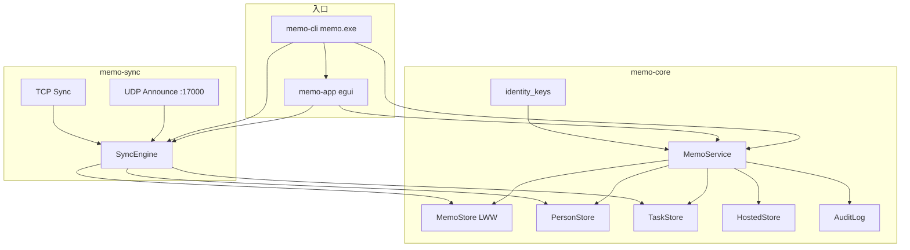
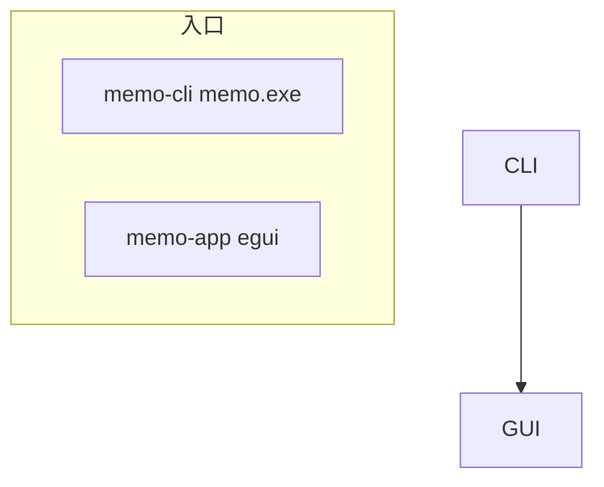

# Mermaid 渲染测试

在 Live 中打开本文件，三组流程图均应显示为 SVG。  
斜杠菜单「Mermaid 图」或「段落 → Mermaid 图」可插入新图；双击图表或点「编辑源码」可改图。

## 1. 标准 mermaid 围栏



## 2. 无语言围栏 + Typora `\[` 转义（应自动识别）

```
flowchart TB
  subgraph entry ["入口"]
    CLI["memo-cli memo.exe"]
    GUI["memo-app egui"]
  end
  subgraph core ["memo-core"]
    ID["identity_keys"]
    SVC["MemoService"]
    MS["MemoStore LWW"]
    PS["PersonStore"]
    TS["TaskStore"]
    HS["HostedStore"]
    AU["AuditLog"]
  end
  subgraph sync ["memo-sync"]
    UDP["UDP Announce :17000"]
    TCP["TCP Sync"]
    ENG["SyncEngine"]
  end
  CLI --> GUI
  CLI --> SVC
  GUI --> SVC
  GUI --> ENG
  CLI --> ENG
  ID --> SVC
  SVC --> MS
  SVC --> PS
  SVC --> TS
  SVC --> HS
  SVC --> AU
  ENG --> MS
  ENG --> PS
  ENG --> TS
  UDP --> ENG
  TCP --> ENG
```

## 3. mermaid 语言 + 历史转义写法（入库会去掉 `\`）



## 说明

- 第 1–3 节应出图。
- 列表下无围栏的缩进 flowchart（如下）不会自动渲染：

* 标签
  flowchart TB
  A --> B
